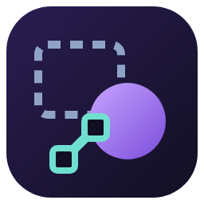
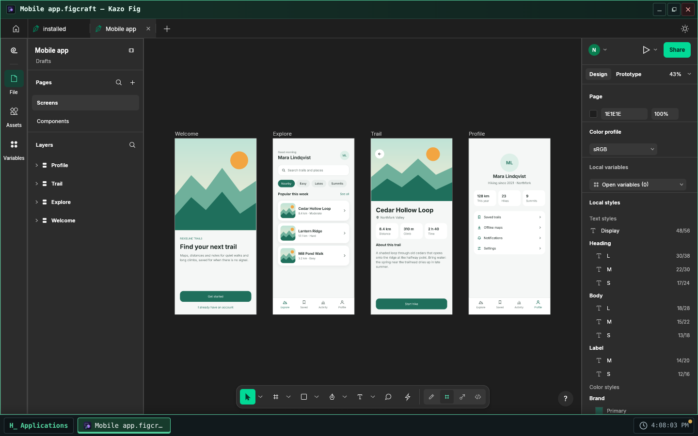
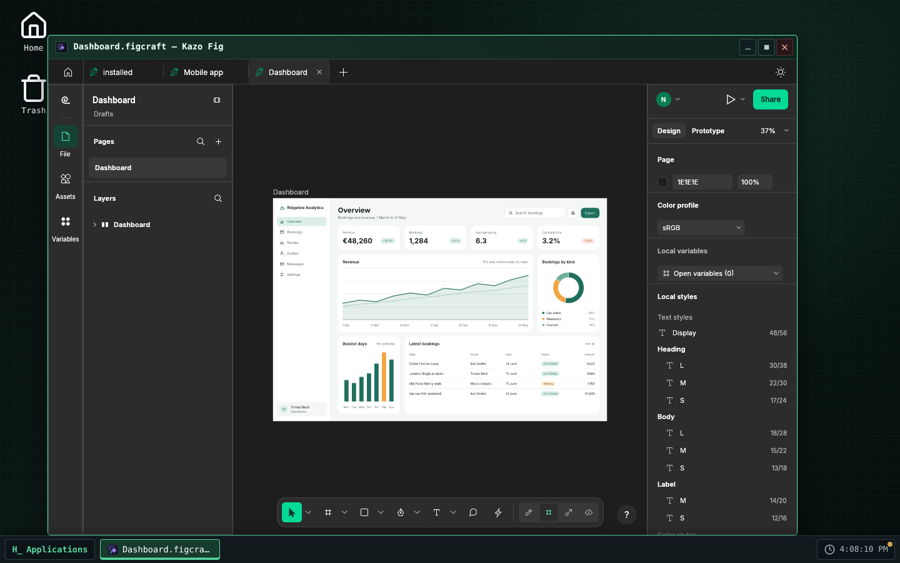
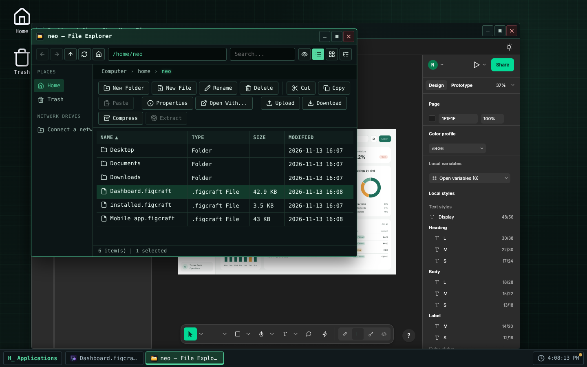

> [Version française](readme-fr.md)

<!-- Store listing: generated from store/ by .github/scripts/store-readme.mjs. Edit store/, then run it. -->



# Kazo Fig

An interface design and prototyping tool for Kazo OS. Kazo Fig is based on
[FigCraft](https://github.com/storytold/figcraft) by the ArtCraft team, an open-source design tool
written in Rust, which runs here in a Kazo OS window.

## Design

- Frames, auto layout (rows, columns, wrap and grid), constraints and layout grids.
- Components, instances with overrides, variants, local styles and variables with modes.
- Vector networks with the Pen and Pencil tools, boolean groups, gradients, image fills, shadows,
  blurs and every blend mode.
- Text edited in place on the canvas, with the open fonts FigCraft includes.
- Prototypes: connections, transitions, a presentation view, and code for the selected layer.
- Several designs in tabs, and several windows at once, each with its own designs.

## Your Kazo OS files

- Double-click a `.figcraft`, `.fig`, `.sketch`, `.penpot` or `.jam` file in the File Explorer, or
  use "Open with" on a `.json`, `.svg` or image file: the design opens in Kazo Fig.
- Save writes `.figcraft`. Each tab is bound to its own file: a `.figcraft` you opened is rewritten
  in place, and saving another tab never overwrites it. A file of another format is never
  overwritten, so its first save asks for a name in the Kazo OS save dialog. Save As
  (Ctrl+Shift+S) and the first save of a new design use that dialog too.
- Exports to PNG, JPG, WebP, SVG and PDF are copies: the design stays bound to its file.
- Closing the window asks before losing unsaved changes, for every open tab.
- File › Open and the pictures you place come from Kazo OS files, through the Kazo OS dialog.
- Kazo Fig follows the OS theme (light or dark) and language; its settings are kept per Kazo OS
  user in `~/.config/ca.kazo.fig/`.

## Known limits

- **FigCraft is in early alpha.** Keep a copy of the designs that matter.
- FigCraft's own File › Save As menu item, on the tab that carries the opened file's name, saves
  under that name: use Ctrl+Shift+S for Save As.
- FigCraft draws with **WebGPU or WebGL 2**: a browser or computer with neither shows an error
  screen instead of the design.
- The download is about 11 MB (26 MB once installed), and each window loads its own copy of
  FigCraft.
- The window stays on the screen where it opened: moving it to another screen would reload
  FigCraft and lose the open designs.
- Needs Kazo OS 3.3.3 or later.

## License

Kazo Fig is free software under the MIT license. FigCraft is under the MIT or Apache-2.0 license;
its notices and the licenses of the fonts it includes ship with the app (see
`THIRD-PARTY-NOTICES.md` in the repository). The ArtCraft name and logos are trademarks of the
ArtCraft team and are not used by Kazo Fig.

## Screenshots

<p>
  
  
  
</p>

<!-- /Store listing -->

## Try it

[Open Kazo Fig in Kazo OS](https://os.kazo.ca/?autolaunch=ca.kazo.fig): the link starts Kazo OS, installs the app from the official Store and opens it.

Or open [Kazo OS](https://os.kazo.ca/) and install Kazo Fig from the **Kazo OS Store** (category Graphics), or in the Kazo OS Terminal, as an administrator: `sudo kazopkg install Kazo-ca/Os-App-Fig`.

## About Kazo OS

[Kazo OS](https://github.com/Kazo-ca/Os) is a simulated operating system that runs in the browser, written in C# with Blazor WebAssembly. It gives a complete environment to build and run applications: desktop and windows, a persistent file system, processes, a POSIX shell, a simulated network, the Kazo OS Store, and a public SDK (NuGet packages) to make apps such as this one. Try it at <https://os.kazo.ca/> (PWA, works offline).

## Development

- Plan: [plan](doc/en/plan.md). FigCraft's notices and the licenses in the package: [THIRD-PARTY-NOTICES.md](THIRD-PARTY-NOTICES.md).

| Folder | Content |
| --- | --- |
| `src/Kazo.Fig` | The app (window app, its `[AppManifest]` class generates `manifest.json`) |
| `src/Kazo.Fig.Os` | A host that runs the whole Kazo OS with the base apps and this app: the project to start |
| `tests/Kazo.Fig.Tests` | Tests of the app |
| `external/KazoOs` | The Kazo OS repository as a git submodule, on a release tag |
| `external/figcraft` | FigCraft's sources (our fork `Kazo-ca/figcraft`) as a git submodule, only to compile FigCraft |
| `tests/installed` | The app as the Store installs it, in a published Kazo OS: `kazopkg install`, a design opened by double-click, the Store screenshots |
| `THIRD-PARTY-NOTICES.md` | FigCraft and what it bundles; linked into the package with `LICENSE` (`wwwroot/legal/`) |
| `src/Kazo.Fig/wwwroot/figcraft` | The FigCraft web build and its provenance `figcraft.json`, never edited by hand |
| `store/` | What the Kazo OS Store shows: icon (PNG 256×256), short descriptions, descriptions, screenshots, `store.json` |

### First steps

```bash
# A repository created from the GitHub template already has the submodule:
git clone --recurse-submodules <your repository>

# A folder made with "dotnet new kazoos-solution" adds it once:
git init
git submodule add --depth 1 https://github.com/Kazo-ca/Os.git external/KazoOs
git -C external/KazoOs checkout v<Kazo OS version>
```

Then open `Kazo.Fig.slnx` in Visual Studio or Rider and start `Kazo.Fig.Os`, or run
`dotnet run --project src/Kazo.Fig.Os`.

### The Kazo OS version

`external/KazoOs/wasm2/KazoOs/build/Versions.props` is the Kazo OS version of this repository.
To move to another version, move the submodule to its tag and commit it:

```bash
git -C external/KazoOs fetch --depth 1 origin tag v2.2.0
git -C external/KazoOs checkout v2.2.0
git add external/KazoOs
```

Never edit the submodule: the OS is not modified from an app repository, and CI refuses a
submodule with local changes or off its tag.

### Two build profiles

| Profile | Kazo OS comes from | Use |
| --- | --- | --- |
| `Debug` | the projects of the submodule (`KazoOsUseSource=true`) | step into the SDK and the OS, breakpoints anywhere |
| `Release` | the `Kazo.Os.*` packages of nuget.org, at the submodule's version | CI, `dotnet publish`, the Kazo OS Store |

Force either one with `-p:KazoOsUseSource=true` or `false`.

### Tests

```bash
dotnet test                       # unit tests (Debug: the Kazo OS projects of the submodule)
dotnet build -c Debug && npm run test:e2e   # Kazo OS in Chromium with Playwright: FigCraft, open, save, close
```

The app as the Store installs it, in a published Kazo OS (not in CI: a few minutes):

```bash
dotnet build src/Kazo.Fig -c Release -t:KazoOsPack
# kazoos-wasm-<version>.zip of a Kazo OS release (3.3.3 or later), unzipped in <os>
npm run test:installed -- <os> [packages folder] [screenshots folder]
npm run test:installed -- --store <os>   # after a release: installs from the real Kazo OS Store
```

It installs Kazo Fig with `sudo kazopkg install Kazo-ca/Os-App-Fig` (GitHub answered from the
local packages), saves a `.figcraft`, double-clicks it in the File Explorer and checks Kazo Fig
opens it. With a screenshots folder it also writes the Store's screenshots (`store/screenshots/`,
FigCraft's own starter templates). After editing `store/`, run `npm run store:readme` so the top
of this page shows the same listing (CI checks it).

### Building FigCraft from source

The app uses the FigCraft build committed in `src/Kazo.Fig/wwwroot/figcraft/`; building the app
does not compile FigCraft. To change FigCraft's version, or to take a fix of our fork, move the
`external/figcraft` submodule to a commit of the fork `Kazo-ca/figcraft` (branch
`kazo/v<version>`), merge that, then run the **Build FigCraft** workflow on the branch from the
Actions tab: it compiles, commits the build on `figcraft/build-<version>-<commit>`, runs CI there
and opens a PR. On a machine, with a checkout of `storytold/craft-fonts` at the revision the
script names (FigCraft's web build embeds its fonts):

```bash
git submodule update --init --depth 1 external/figcraft
rustup target add wasm32-unknown-unknown   # Rust 1.95 or later; Trunk 0.21.14
tools/build-figcraft.sh --craft-fonts ../craft-fonts
```

`tools/vendor-figcraft.sh` alone takes back the official zip pinned by SHA-256. The tests
check that the provenance names either that zip or the submodule's commit.

### Publishing to the Kazo OS Store

1. Fill `store/` (icon, short descriptions, descriptions, category and tags in `store.json`).
2. Change `Version` in the app's `[AppManifest]` class and commit it to `main`, then tag it: run the
   **Tag a release** workflow (Actions tab, or the GitHub API for an agent), which tags the head of
   `main` with the manifest's version and starts the two publishing workflows; or push the tag
   yourself: `git tag v1.0.0 && git push --tags`.
3. The **Publish to the Kazo OS Store** workflow builds the app and makes the catalog folder
   `apps/<appId>_<version>/`. With a `HACK_STORE_TOKEN` secret (a token allowed to fork and open
   pull requests), it opens the pull request to `Kazo-ca/Os-AppMarketPlace` from your fork;
   without it, download the run's artifact and open the pull request yourself.

`HACK_STORE_TOKEN` is a GitHub personal access token of yours, not something Kazo OS gives you:

1. GitHub ▸ **Settings** ▸ **Developer settings** ▸ **Personal access tokens** ▸ **Tokens (classic)** ▸
   **Generate new token (classic)**, with a short expiration and the **`repo`** and **`workflow`**
   scopes (a fine-grained token cannot cover both your fork and the catalog's repository).
2. Copy it (shown once) into this repository: **Settings** ▸ **Secrets and variables** ▸ **Actions** ▸
   **New repository secret**, name `HACK_STORE_TOKEN` (or `gh secret set HACK_STORE_TOKEN`).

`repo` reaches all your repositories: keep the token only in this secret and revoke it if in doubt.

The catalog never takes a binary from you: once your pull request is reviewed and merged, its CI
compiles the app at the tagged commit.

### Publishing on the `kazoos-packages` branch

The same `v*` tag also runs **Publish the Kazo OS packages**: it packs the app and pushes it to the
`kazoos-packages` branch of this repository, keeping the versions already published. Kazo OS
users then install it with `kazopkg install <owner>/<repo>`, without the Kazo OS Store.

These packages are not signed: apps are signed only in the Kazo OS Store repository
(`Kazo-ca/Os-AppMarketPlace`), when it builds your app from the catalog (ADR 0219). Kazo OS checks
them by their SHA-256 and asks an administrator before installing from an untrusted source. Users
who want a signed package install your app from the Kazo OS Store.
